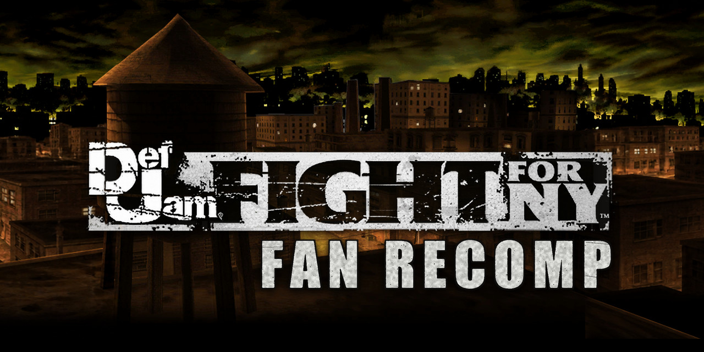
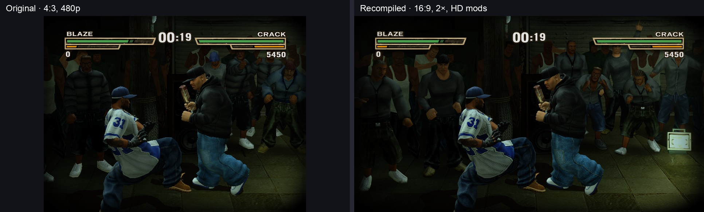
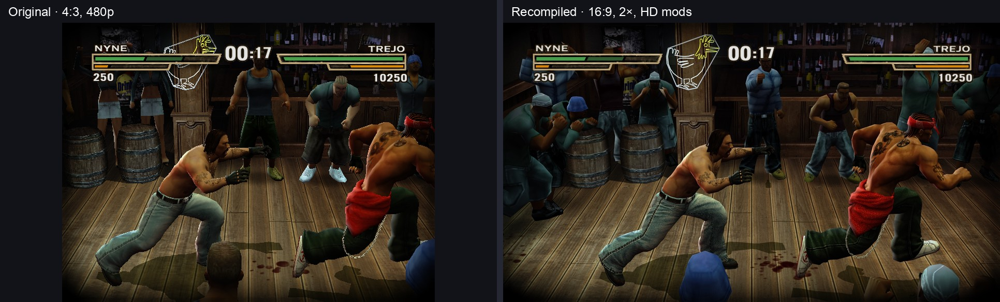
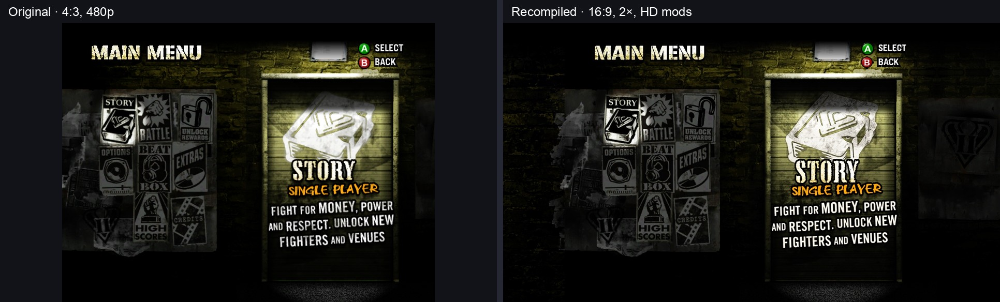
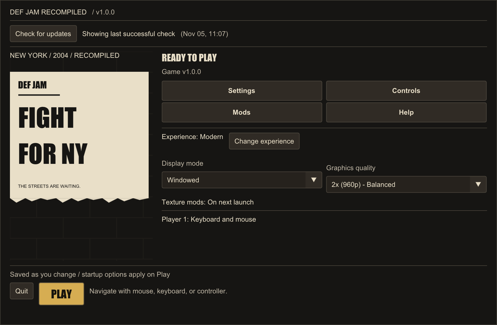

# Def Jam: Fight for NY — Recompiled

Bring **Def Jam: Fight for NY** to Windows, macOS and Linux, including the Steam Deck.
This unofficial native port recompiles the original Xbox game for your computer,
with higher rendering resolution, modern controller support, extensive mod support, and other PC-specific enhancements.

**This is the definitive port of the game.** All game functionality is working and we are continuously optimizing, enhancing, and bugfixing based on player feedback. The project's roadmap now focuses on expanding game moddability, gameplay, and presentation.

You need **your own supported USA Xbox dump**. The app checks your copy and builds
the game on your computer. PS2 and GameCube copies cannot be used.

**[Download Def Jam Recompiled for your platform](https://github.com/vyanhursky/DefJamFFNY-recomp/releases/latest)** ·
[Website](https://vyanhursky.github.io/DefJamFFNY-recomp/) ·
[Install guide](docs/install-guide.md) · [Documentation](docs/README.md) ·
[Report a problem](https://github.com/vyanhursky/DefJamFFNY-recomp/issues/new/choose) ·
[Join the Discord](https://discord.gg/xNvBs23ZBw)

## Gameplay

Blaze vs Fat Joe at The Foundation

Nyne vs Trejo at The Limit

Main Menu

https://github.com/user-attachments/assets/3122b1fa-02f6-4ed0-806b-ad396332bd61

**[Drag the before-and-after sliders on the website](https://vyanhursky.github.io/DefJamFFNY-recomp/#screens)**

## One app for everything

**Def Jam Recompiled** sets up the game, then handles Play, settings, controls, mods,
updates, repair and uninstall. It holds no game files: it checks your own copy and builds
the game on your computer. See [the app and overlay guide](docs/launcher-and-overlay.md).

## Features

- **Native on three platforms.** Windows x64 uses Direct3D 11; Apple Silicon
  Macs and x86-64 Linux use Vulkan. Steam Deck runs the Linux version natively.
- **60 fps, up to 4× resolution.** The port targets 60 frames per second, with 1×–4×
  internal resolution in a resizable window or borderless full screen. We're optimizing for
  low-powered hardware: Steam Deck hits a steady 60 fps in all game modes at 2× render resolution
  with all HD texture mods enabled. Performance depends on your hardware, settings and the scene.
- **Widescreen, up to 32:9.** Windows, macOS and Linux/Steam Deck support 16:9 and 16:10
  ratios, as well as ultrawide up to 32:9. Download the HD Widescreen Menus mod in the app to
  transform every menu and background to match. Original 4:3 is one setting away.
- **Play in your language.** Translation mod support is here. Spanish and French are the
  first additional languages: ZARF's Spanish mod in the catalogue, and the disc's own French
  as a setting.
- **Mod support.** Texture and language mods are here, with a curated catalogue in the app.
  Custom fighters, stages and game modes are coming up on the roadmap.
- **Your own music.** Add MP3, FLAC, Ogg or WAV songs and play them in the Beatbox, menus and
  fights. The cut song "Holler If Ya Hear Me" is restored too. Manage your music on the
  Songs page; see [Custom songs](docs/custom-songs.md).
- **Controllers and keyboard.** Xbox, DualSense, Switch Pro and other supported gamepads,
  with remapping, hot-plug and rumble. Keyboard and mouse buttons can supply gameplay bindings;
  the app and settings support a pointer.
- **One app for everything.** Setup, Play, settings, controls, mods, updates, repair and
  uninstall all live in Def Jam Recompiled. Press F1 during play, or a configured controller
  shortcut, to change settings in the game.
- **Cheat menu.** Infinite health, max Blazin', giant and tiny fighters, fighter swaps, Story
  cash and development points.
- **Add to Steam.** On Windows, Linux and Steam Deck, one button beside Play puts the game in
  your Steam library, artwork included.
- **Upscaled Original Textures.** The app can generate 4× versions of the game's textures from
  your copy, on your computer, with no GPU, AI model or downloaded artwork. Further restored
  textures can be downloaded in Mods.
- **Up to four local players.** Play with gamepads and a keyboard player.
  Network multiplayer is not supported.
- **EA's developer menu, restored.** The game's own debug menu, cut off in the retail
  build, opens from the overlay (Diagnostics tab): set up any match with any fighters, venue and
  match type, play any Story scene, or look at a venue in the stage viewer. See
  [The developer menu](docs/developer-menu.md).

## Get started

1. Have your own USA Xbox disc image or extracted dump matching the
   [supported dump manifest](config/dump-manifest.json).
2. Download **Def Jam Recompiled** for your platform from the
   [latest release](https://github.com/vyanhursky/DefJamFFNY-recomp/releases/latest).
3. Open it, choose your copy and the Modern or Original experience, and optionally add Upscaled
   Original Textures. The app then verifies your copy, recompiles and builds the game.
4. Select **Play**.

| Platform | Download | Guide |
|---|---|---|
| Windows x64 | `DefJamRecompiled-<version>-windows-x64.exe` | [Windows](docs/install-guide.md#windows) |
| macOS, Apple Silicon | `DefJamRecompiled-<version>-macos-arm64.zip` | [macOS](docs/install-guide.md#macos) |
| Linux x86-64 / Steam Deck | `DefJamRecompiled-<version>-linux-x86_64.AppImage` | [Linux and Steam Deck](docs/install-guide.md#linux-and-steam-deck) |

Also available on [RecompLauncher](https://recomplauncher.com/game/defjamffny-recomp) and
[Quiver](https://quiverlauncher.com/apps/def-jam-fight-for-ny-def-jam-fight-for-ny-fan-recomp).

The app builds from your copy rather than downloading a precompiled game.
The [install guide](docs/install-guide.md) covers requirements, unsigned-app prompts,
disk space, updates and repairs, with a screenshot of each setup step.
Upscaled Original Textures need additional disk space and install time.

Already installed with the older setup? Choose **Use an existing installation** in the app, and
your saves, settings and mods are kept. Releases from v1.1.0 publish only the app packages;
the older [setup installers](docs/setup-installer.md) remain available on earlier releases. Prefer a manual source build? Use
[Build and play](docs/build-and-play.md) for Windows or
[Build on macOS and Linux](docs/build-macos-linux.md).

[v1.1.1](docs/releases/v1.1.1.md) fixes Windows updates blocked by an older launcher
and improves interrupted-update recovery on all platforms.

## Customize your game

Use the app or F1 overlay to change display settings, controls and mods.
The same options are stored in `settings.ini` in your data folder.

- [App and overlay](docs/launcher-and-overlay.md)
- [Controllers, keyboard and mouse](docs/10-input.md)
- [Settings reference](docs/settings-reference.md)
- [Texture Modding — Getting Started](docs/texture-modding-getting-started.md)
- [HD texture packs: generate, install and enable](docs/hd-textures.md)
- [Language packs](docs/language-packs.md)

### Texture and language mods

**Available now:** texture replacement packs, including the Upscaled Original Textures the app
generates, language mods, and reviewed catalogue downloads such as HD Widescreen Menus. Enable
mods and set their priority on the app's Mods page.

Want to make a pack? Start with **[Texture Modding — Getting Started](docs/texture-modding-getting-started.md)**:
find an original texture, edit it, write a manifest, test the result and share it.
The [format reference](docs/hd-textures.md) and [mod-manager reference](docs/mod-manager.md)
cover the technical details. Language mods have their own
[delta format](docs/language-packs.md).

Your own music is supported separately on the Songs page: [add and manage songs](docs/custom-songs.md).

**Coming up:** custom fighters, stages and game modes. See the roadmap below.

## Where the project is heading

The project aims to preserve the original game's experience while making it
easier to play and customize on modern computers.

| Direction | Goal |
|---|---|
| Engine optimizations | Improve performance on low-spec machines, stay up to date with [xboxrecomp](https://github.com/sp00nznet/xboxrecomp), and contribute improvements upstream. |
| Port accuracy | Keep the visuals, tone and gameplay feel faithful to the original Xbox game. |
| Fully unlocked frame rates | Support frame rates above 60 fps while preserving game speed, timing and gameplay feel. Future work; not supported by the current release. |
| Widescreen refinement | Improve edge cases and broader aspect and venue coverage. |
| Extensible Custom Fighter Mod support | Add your own fighters to the game. |
| Additional HD Upscaling mods | Story Fighter customization, plus Stages and Level textures. |
| Def Jam: The Takeover expansion | Bring the mechanics and story mode from Def Jam: The Takeover into this game. |
| Broader mod support | Custom stages and game modes, difficulty changes and restored cut content. |
| Build and release automation | Improve automation and the gameplay test harness so shipping builds have reliable, repeatable validation. |
| Deeper gameplay decompilation | Long-term stretch goal. |

These are directions, not promised release dates. [GitHub Issues](https://github.com/vyanhursky/DefJamFFNY-recomp/issues),
[milestones](https://github.com/vyanhursky/DefJamFFNY-recomp/milestones) and
[open PRs](https://github.com/vyanhursky/DefJamFFNY-recomp/pulls) track concrete work.

## Compatibility and known limits

The released build targets Windows x64, Apple Silicon macOS and x86-64 Linux.
Steam Deck has automated regression coverage and maintainer playtesting;
Proton is untested. Performance varies with hardware, settings and scenes.
Release-specific test qualifications are recorded with the release; open reports
and follow-up work are tracked in GitHub Issues.

Check both [GitHub Issues](https://github.com/vyanhursky/DefJamFFNY-recomp/issues) and the
[latest release notes](https://github.com/vyanhursky/DefJamFFNY-recomp/releases/latest).
Some release-specific fixes and validation limits appear in the notes first.

## Community

This project is in very active development, and the
**[Def Jam: Fight for NY Recomp Discord](https://discord.gg/xNvBs23ZBw)** is where
we collaborate and talk it through. Join to:

- follow and discuss development as it happens;
- share player feedback and ask for help getting set up;
- suggest enhancements and ideas for the port;
- talk about mods and texture packs.

Discord is for conversation. Please still file bugs as
[GitHub issues](https://github.com/vyanhursky/DefJamFFNY-recomp/issues/new/choose)
so they are tracked, and never share game files or dumps there either.

## Help improve the port

[Report a problem](https://github.com/vyanhursky/DefJamFFNY-recomp/issues/new/choose)
with your version, operating system, CPU/GPU, controller, reproduction steps and
relevant log lines. Remove personal paths, and please don't attach F9 bug bundles, game
files, saves or memory dumps. See [Contributing](CONTRIBUTING.md) for reporting guidance,
development setup and the tests a change needs.

Bug fixes, platform testing and documentation improvements are welcome.
The [gameplay test harness](docs/09-testing-harness.md) explains automated game
checks and their limits. GitHub CI also runs checks that need no game data;
a passing CI badge does not establish full campaign compatibility.

## How it works

The [xboxrecomp](https://github.com/sp00nznet/xboxrecomp) toolchain translates the
Xbox executable into C, which is compiled ahead of time. The game's code runs
through an Xbox compatibility runtime, with graphics, audio and input supplied
by your computer. This is a static recompilation port; deeper gameplay
decompilation remains future work.

The repository distributes maintained port code, build tools and documentation.
It does not distribute a disc image, playable game data, translated game source
or a compiled game executable. The repository does include selected approved
screenshots and branding artwork; those retain their original ownership.

## Credits and licensing

Maintained by **vyanhursky**, with development assistance from Claude Code and
Codex. Built on **sp00nz's xboxrecomp** and work from the Xbox emulation
community, including xemu hardware references and attributed toolkit components.
[Burnout 3](https://github.com/sp00nznet/burnout3) and
[Mercenaries Recompiled](https://github.com/KraftMacAndChee/Mercenaries-Recompiled)
are related projects that helped shape the documentation.

The project's code is [MIT licensed](LICENSE). Toolkit components retain their
own licenses; see the [toolkit NOTICE](https://github.com/vyanhursky/xboxrecomp/blob/d569ca10811cef67ec4e9fa2173088c2f9fd0580/NOTICE)
and [license texts](https://github.com/vyanhursky/xboxrecomp/tree/d569ca10811cef67ec4e9fa2173088c2f9fd0580/LICENSES).
The license grants no rights to the game or its artwork.

This is an unofficial fan project, not affiliated with Electronic Arts, AKI or
Def Jam. Def Jam: Fight for NY and its assets belong to their respective owners.
