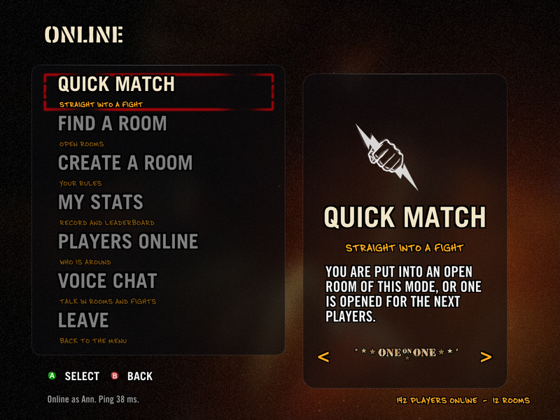
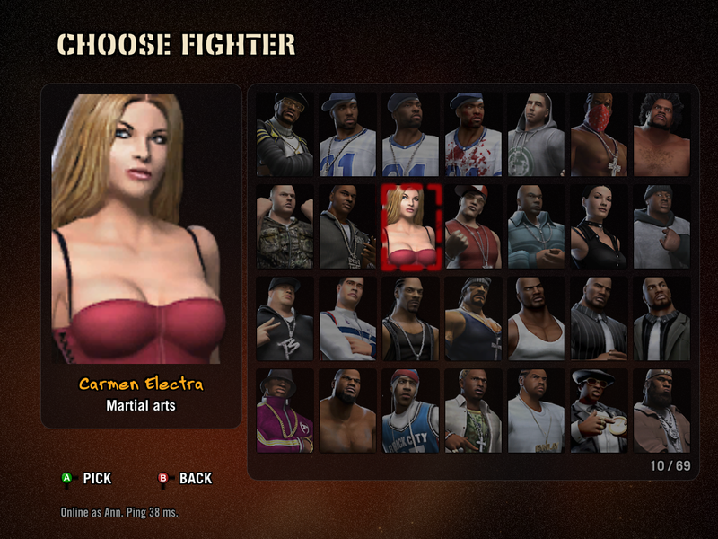
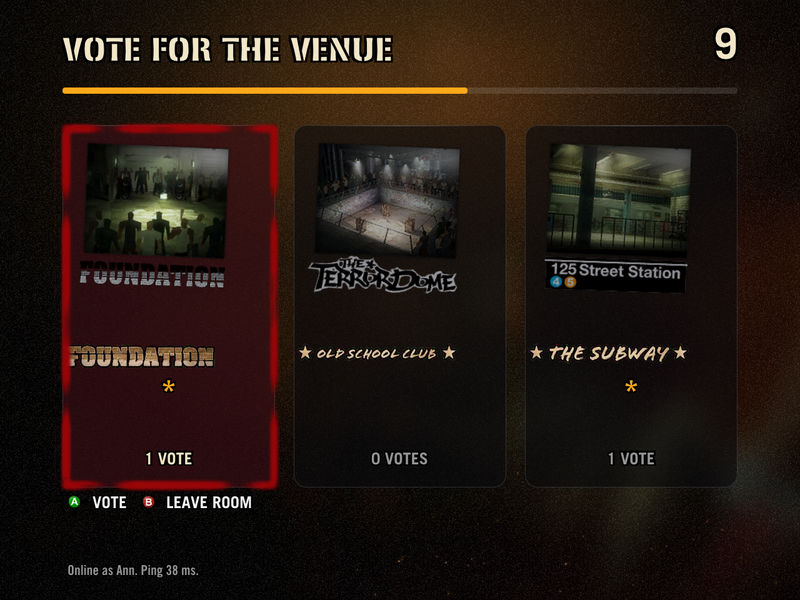
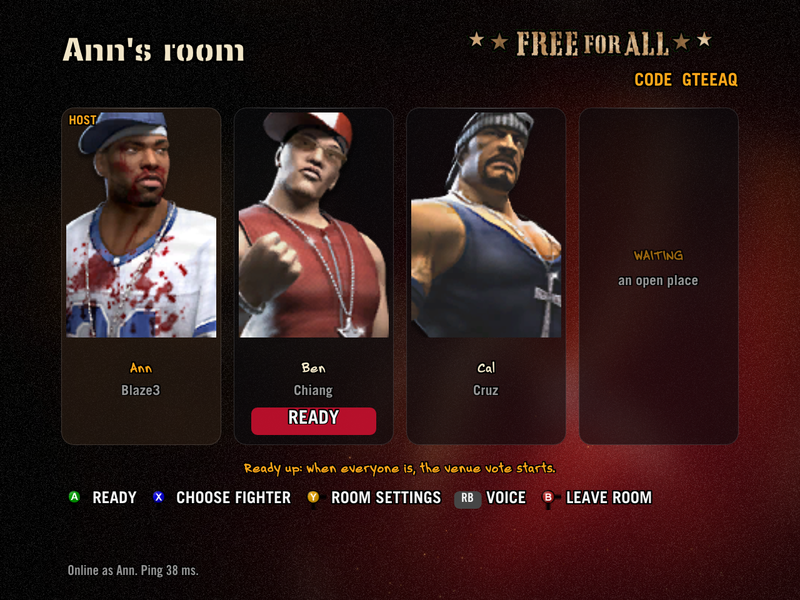
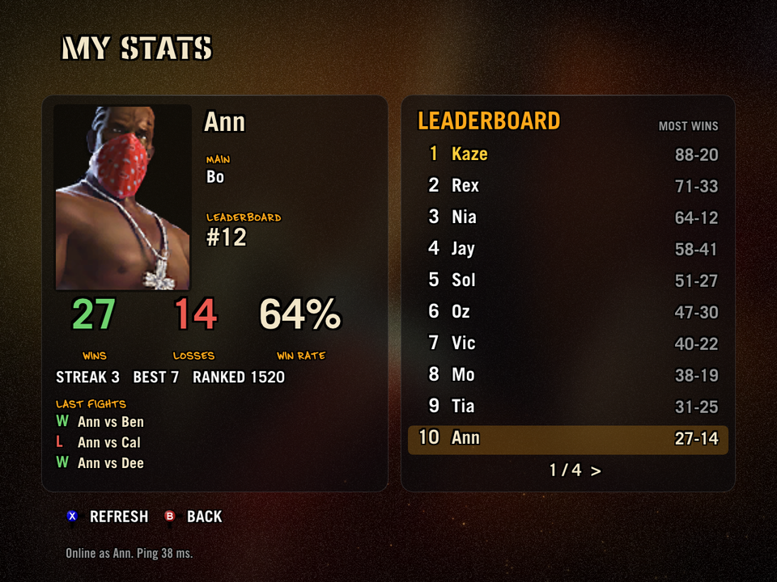
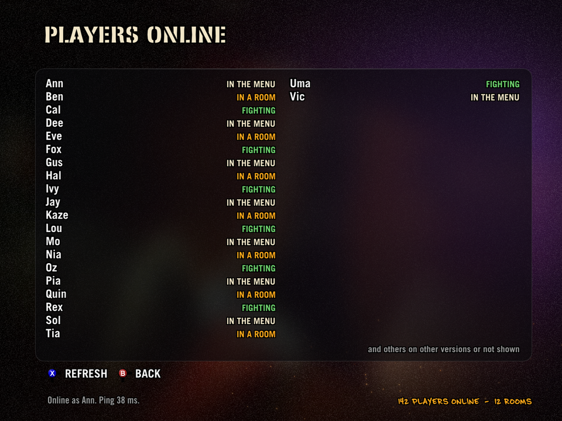
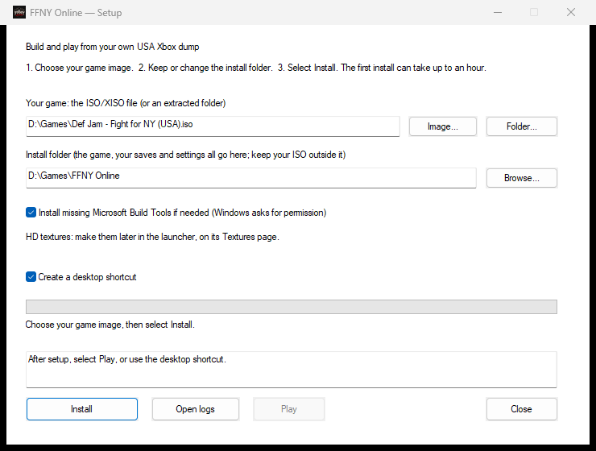
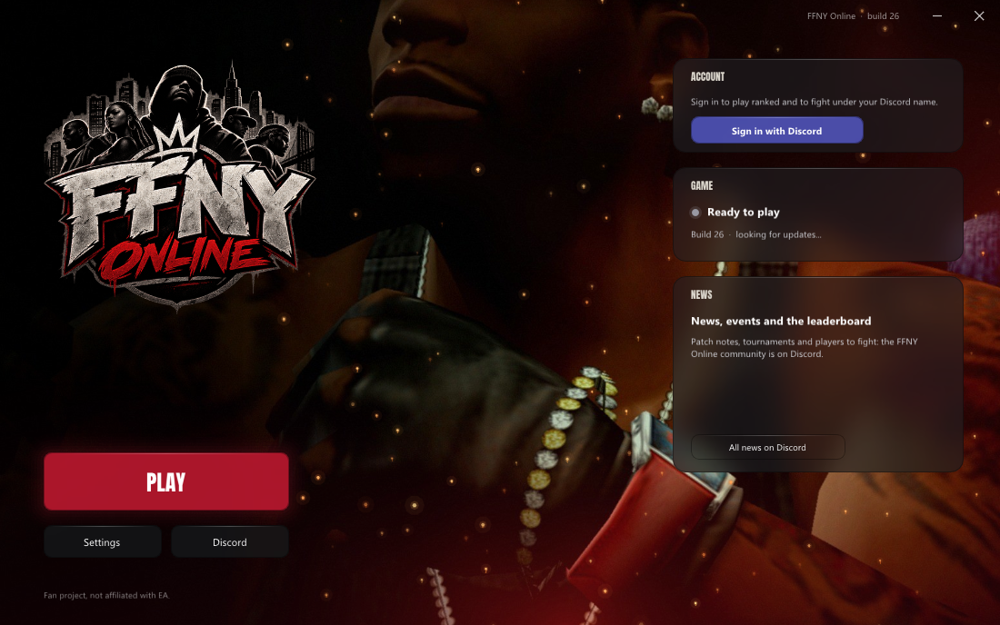

<p align="center"></p>

# FFNY Online — Def Jam: Fight for NY on PC, with online multiplayer

[](https://github.com/sweeax-exe/ffny-online/releases)
[](LICENSE)
[](https://discord.gg/zCZKVDnKaP)
[](https://ko-fi.com/ffnyonline)

**FFNY Online** is an unofficial fan project that brings **Def Jam: Fight for NY** to the PC
and adds what the original never had: **online multiplayer**, with quick match, rooms, a
venue vote and fights in lockstep, right in the game's own main menu. It builds on
[Vlad Yanhursky's Def Jam: Fight for NY Recompiled](https://github.com/vyanhursky/DefJamFFNY-recomp),
the native PC port this project is a fork of; all credit for the port itself goes there.

The port is built from the original Xbox
version with [xboxrecomp](https://github.com/sp00nznet/xboxrecomp). The Xbox
executable is translated into C and compiled ahead of time. The game's own
gameplay, menus and cutscenes run on an Xbox compatibility runtime, drawn through
Direct3D 11 on Windows and Vulkan on macOS and Linux, with sound and controllers supplied
by the host.

**The Windows build is playable.** Menus, Story mode and fights run at 60 fps
with sound. It is still an early release: see [known issues](docs/known-issues.md).

You need your **own Xbox game dump**, and the game is built on your machine.
This repository holds the port's code, tools and documentation. It contains no
game assets, disc images, translated game code or game executable.

[Install and build](docs/build-and-play.md) · [Online play](docs/netplay.md) ·
[Documentation](docs/README.md) · [Known issues](docs/known-issues.md) ·
[Contributing](CONTRIBUTING.md) · [Releases](https://github.com/sweeax-exe/ffny-online/releases) ·
[Discord](https://discord.gg/zCZKVDnKaP) · [Support the servers](https://ko-fi.com/ffnyonline)

## Online play

Choose **ONLINE** in the main menu (the poster in the bottom-left slot):

- **Quick match** puts you straight into a room of the mode you pick, or opens one for the next
  players.
- **Rooms**: the list of open rooms, your own room (mode, players, the venues to vote on, listed
  or by code only), and joining a friend by code.
- **In the room** you pick your fighter from the roster and ready up; then everyone votes on
  the venue (three candidates, 15 seconds) and the match starts by itself on every PC.
- **Modes**: One on One, 3-Way and Free for All (up to four players, CPU fighters fill free
  places).
- **Fights run in lockstep**: every PC simulates the same fight from the same inputs, with an
  input delay set from the players' pings. The relay server only forwards inputs; it never sees
  game data.
- **Updates** arrive through the launcher, signed, so you and your friends stay on the same build.
- **Stats and leaderboard** (build 13): signed in with Discord, MY STATS shows your record, main fighter and last fights, with a leaderboard; PLAYERS ONLINE shows who is around. On the Discord: `/profile` and `/leaderboard`.
- **The crowd stays in sync** (build 13): crowd catches, holds and weapons work online, the same on every PC.
- **Sign in with Discord** (optional, launcher → Online): you appear online with your Discord name;
  ranked play builds on it. Only your Discord name, id and avatar are stored
  ([privacy](https://play.defjam.online/privacy)), and the launcher can delete the account.

<table>
<tr>
<td></td>
<td></td>
</tr>
<tr>
<td></td>
<td></td>
</tr>
<tr>
<td></td>
<td></td>
</tr>
<tr>
<td></td>
<td></td>
</tr>
</table>

Online play is Windows only for now. Details: [Online play](docs/netplay.md).

## Features

- **Native on Windows, macOS and Linux.** Direct3D 11 on Windows x64, Vulkan on
  Apple Silicon Macs and on x86-64 Linux, including the Steam Deck.
- **Controllers, keyboard and mouse.** Xbox (XInput), DualSense, Switch Pro and
  most other gamepads, with rumble, hot-plug and remapping. The keyboard and
  mouse play as a player of their own. Up to four players locally.
- **Higher resolution.** Renders at up to 4× the console's resolution, in a
  resizable window or borderless full screen.
- **Optional HD textures.** 4× texture packs generated on your machine from
  your own dump (Windows and macOS).
- **An installer that builds the game for you.** Point the Windows setup wizard
  at your dump; it checks it, then translates and compiles the game locally.
- **Launcher and in-game settings.** A start-up window and an overlay (F1) for
  display, texture, controller and key settings, usable with mouse, keyboard or
  pad (Windows, macOS and Linux).
- **Your saves stay local.** Profiles live in your data folder and survive
  updates and repairs.
- **Online multiplayer** in the game's own menus (Windows), and updates from the launcher.

## Gameplay


Gameplay captured by the maintainer. The GIF is a short, silent preview.

## Status

| Area | Status |
|---|---|
| Windows x64 | Playable; tested on Windows 11 |
| macOS (Apple Silicon) | Playable through Vulkan since v0.5.0, with a setup installer and optional HD textures since v0.6.1 and the launcher and overlay since v0.6.2; see [macOS setup](docs/setup-installer.md#macos-setup-apple-silicon) |
| Linux (x86-64) | Builds and runs natively through Vulkan, with the launcher and overlay of v0.6.2; see [Build on macOS and Linux](docs/build-macos-linux.md) |
| Steam Deck | Native (Vulkan, PipeWire sound, the Deck's controls as a pad), installed by the [Linux setup](docs/setup-installer.md#linux-setup) with an optional Steam shortcut for Gaming Mode; automated regression and owner play-test on the Deck; a little audio distortion remains ([#11](https://github.com/vyanhursky/DefJamFFNY-recomp/issues/11)). Proton not tried. See [Steam Deck](docs/build-macos-linux.md#steam-deck) |
| Menus and fights | Menus, match setup, fights and the return to the menus work |
| Story | Intro and cutscenes, character creator, crib and gym work; a full playthrough has not been verified |
| Graphics | Direct3D 11 at up to 4× the console resolution; 4:3 picture (true 16:9 is planned) |
| HD textures | Optional 4× texture packs, generated locally from your own dump; on Windows and (since v0.6.1) macOS; see [HD textures](docs/hd-textures.md) |
| Audio | Music, speech and effects |
| Input | Gamepads (Xbox, DualSense, Switch Pro and most others), keyboard and mouse, rumble and remapping; see [Controllers, keyboard and mouse](docs/10-input.md) |
| Launcher and overlay | A start-up window and an in-game settings overlay (F1) on Windows and (since v0.6.2) macOS and Linux; see [Launcher and overlay](docs/launcher-and-overlay.md) |
| Saves | Local profiles in your data folder |
| Online multiplayer | Windows: hub, rooms, quick match, venue vote, 2-4 players in lockstep; tested with two players. Not yet on macOS and Linux |

## Install

Only the **USA Xbox version** matching the [dump manifest](config/dump-manifest.json)
is supported. PS2 and GameCube copies cannot be used. How to make a dump of your own disc:
[Dump your own disc](docs/dump-your-disc.md).

### Windows: setup installer

Download `DefJamSetup-<version>-windows-x64.exe` from the
[latest release](https://github.com/sweeax-exe/ffny-online/releases/latest).
The installer contains no game. It takes your disc image or extracted dump,
checks it, then translates and compiles the game on your machine. It bundles
Python and the pinned build sources and can install Microsoft's C++ Build Tools
if they are missing. The installer is unsigned, so Windows may warn about it.



See [Windows setup](docs/setup-installer.md) for folders, shortcuts, HD texture
generation, silent mode, repair and removal.

### macOS: setup installer (Apple Silicon)

Download `DefJamSetup-<version>-macos-arm64.dmg` from the
[latest release](https://github.com/sweeax-exe/ffny-online/releases/latest)
and open `Def Jam Setup`. It has the same steps as the Windows wizard, needs no
Terminal, Homebrew or build tools of your own, and works without an internet
connection. It does need Apple's free **Xcode Command Line Tools**; if they are
missing, setup stops and links Apple's
[installation instructions](https://developer.apple.com/documentation/xcode/installing-the-command-line-tools/).
The setup is unsigned, so macOS blocks it the first time: choose **Done**, then
open System Settings, Privacy & Security, scroll to Security and choose **Open
Anyway**. See [macOS setup](docs/setup-installer.md#macos-setup-apple-silicon) for
folders, shortcuts, silent mode and removal.

### Linux and Steam Deck: setup

Unpack `DefJamSetup-<version>-linux-x64.tar.gz` and open `DefJamSetup.sh` (on the
Steam Deck, in Desktop Mode: double-click it and choose Execute). It has the same
steps as the other wizards, plus **Add to Steam** so the game starts from Gaming
Mode. A computer with no compiler of its own, like the Steam Deck, builds in a
container that setup fetches once (about 1 GB), so the first install needs an
internet connection; the game then runs on the computer's own SDL3, Vulkan and
shaderc. See [Linux setup](docs/setup-installer.md#linux-setup).

### Windows: build from source

You need Git, Python 3.12 or newer, Visual Studio Build Tools with the C++
workload, and a Direct3D 11 GPU.

```powershell
git clone --recursive https://github.com/sweeax-exe/ffny-online.git
cd ffny-online
```

Follow [Build and play](docs/build-and-play.md) to choose a data folder and
extract and verify your disc. Then:

```powershell
.\scripts\analyze.ps1
.\scripts\recomp.ps1
.\scripts\build.ps1 -Preset win-x64-release
.\scripts\run.ps1 -Preset win-x64-release
```

Use a recursive clone: GitHub's source ZIP leaves out the toolkit submodule.

### macOS and Linux: build from source

On a Mac or on Linux, the setups above are the easy way. To build by hand, follow
[Build on macOS and Linux](docs/build-macos-linux.md). It lists what works there
and what does not yet.

## Playing

The game opens a launcher window with display, controller and key settings and
a Play button. The same settings are available in the game with F1, and in
`settings.ini` in your data folder.



- [Launcher and overlay](docs/launcher-and-overlay.md)
- [Controllers, keyboard and mouse](docs/10-input.md)
- [settings.ini and keybinds](docs/settings-reference.md)
- [HD textures](docs/hd-textures.md)

## Testing

Tests that need no game data, which is also what GitHub CI runs:

```powershell
python -m pip install pytest pyxbe capstone Pillow numpy
python -m pytest -q tests/unit
python scripts/check-source-tree.py
```

Tests that play the game need a local build made from your own dump:

| Command | Time | Covers |
|---|---|---|
| `python scripts/regress.py --quick` | about 10 minutes | unit tests, three reference frames and one fight |
| `python scripts/regress.py` | about an hour | adds four-fighter and two-pad matches, combat results, a replay check, Story routes and a boot soak |

Do not run two game tests at once: they share the save area and the window.
The [gameplay test harness](docs/09-testing-harness.md) guide explains each
check and its report, and [CONTRIBUTING.md](CONTRIBUTING.md#testing) says which
tests a change needs.

## Reporting problems

Open an [issue](https://github.com/sweeax-exe/ffny-online/issues/new/choose)
and pick the form that fits, or a ticket in #get-help on the [Discord](https://discord.gg/zCZKVDnKaP). Check [known issues](docs/known-issues.md) first.
A useful report has:

- the release version or commit, and whether you used the installer or a source build;
- your operating system, CPU, GPU and controller;
- the steps that lead to the problem, and what you expected instead;
- the relevant lines of the log (`logs/run-*.log.err` for a source build, or the
  installer log under `%LOCALAPPDATA%\DefJamSetup\logs`). Remove personal paths first.

Never attach game data: no disc images, game files, translated game code, saves,
memory dumps or audio recordings. A screenshot of the problem is fine.

## Contributing

Bug fixes, platform work and documentation are welcome. [CONTRIBUTING.md](CONTRIBUTING.md)
covers the development setup, where each kind of change belongs, the tests to
run and what a pull request needs. Changes to the generic runtime or translator
go to the [toolkit fork](https://github.com/vyanhursky/xboxrecomp), and from
there upstream where they help other games.

## Roadmap

Released so far: display settings and a settings file, gamepad and keyboard
input, the launcher and overlay (Windows, then macOS and Linux), native macOS and Linux builds
(the Steam Deck included), the Windows, macOS and Linux installers and optional HD textures. Still planned:

- true 16:9 widescreen in fights;
- deeper gameplay decompilation, as a stretch goal.

See the [roadmap](docs/01-plan-review.md#corrected-roadmap-milestones-with-exit-criteria),
the [PC features plan](docs/07-m6-plan.md) and the [improvement backlog](docs/04-improvement-backlog.md).
The [release notes](docs/releases) record what each version changed.

## Credits and licensing

**FFNY Online** (online play, the in-game online screens, the update service and the relay) is
maintained by **sweeax-exe**, with development assistance from Claude Code.

The PC port it builds on, **[Def Jam: Fight for NY Recompiled](https://github.com/vyanhursky/DefJamFFNY-recomp)**,
is by **Vlad Yanhursky (vyanhursky)**, with development assistance from Claude Code
and Codex. The port builds on **sp00nz's xboxrecomp** and on work from the Xbox
emulation community. xemu provides hardware references and attributed components
in the toolkit. [Burnout 3](https://github.com/sp00nznet/burnout3) and
[Mercenaries Recompiled](https://github.com/KraftMacAndChee/Mercenaries-Recompiled)
are related projects that helped shape the documentation.

This repository's code is [MIT licensed](LICENSE). Toolkit components keep their
own licenses, including LGPL-2.1-or-later components; see the toolkit's
[NOTICE](https://github.com/vyanhursky/xboxrecomp/blob/4bff2573127c5499ad795d58ddd90159240520bd/NOTICE)
and [license texts](https://github.com/vyanhursky/xboxrecomp/tree/4bff2573127c5499ad795d58ddd90159240520bd/LICENSES).
The license grants no rights to the game or its assets.

This is an unofficial fan project, not affiliated with Electronic Arts, AKI or
Def Jam. Def Jam: Fight for NY and its assets belong to their respective owners.
