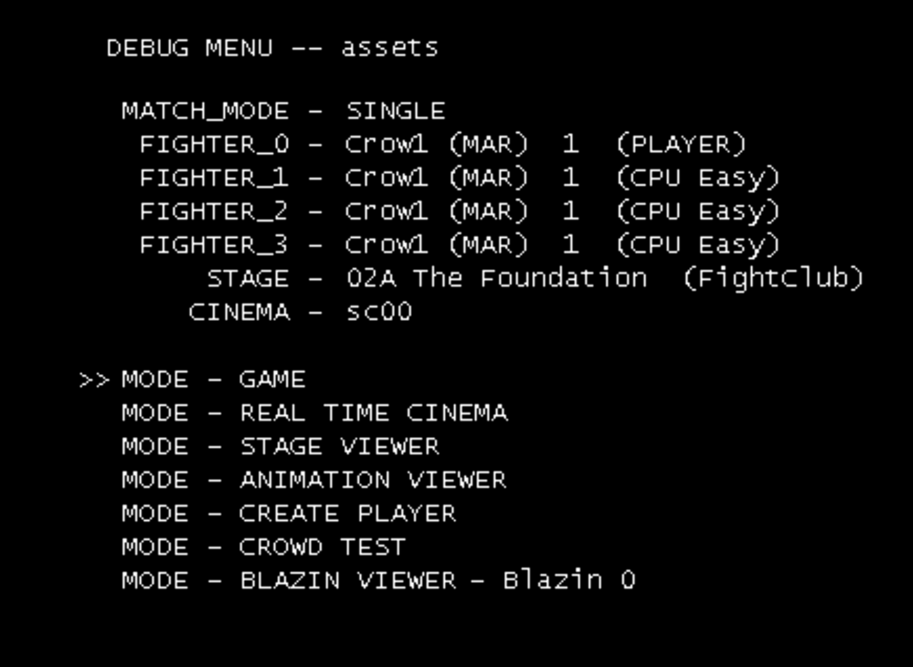

# The developer menu

Def Jam: Fight for NY still contains the debug menu EA's developers used: set up any match
(any fighters, any venue, any match type), play any Story scene, and look at a venue in a viewer.
The retail game can never open it, because the module that runs it was cut off from the build.
Since v0.10.0 the port rebuilds that module from outside the game, so the menu works again. The
game's data is not changed, and nothing is different unless you open the menu. How it was
restored is in [the research notes](research/dev-module-revival.md).



## Opening and leaving it

- **In the game:** open the overlay (**F1**, or the pad's overlay buttons), go to **Diagnostics**, and
  under **Story scenes** press **Developer menu**. Close the overlay. The menu replaces what
  was running (tested from the main menu); leaving it later goes to the main menu, not back there.
- **At start-up:** set `RECOMP_DEV_MODULE=1` and the menu opens as soon as the title screen is up:

  ```bash
  RECOMP_DEV_MODULE=1 ./build/posix-release/defjam_recomp
  ```

  ```powershell
  $env:RECOMP_DEV_MODULE = "1"; .\build\win-x64-release\defjam_recomp.exe
  ```

- **Leaving:** the overlay's **Back to the main menu** button, or **Start** in the menu and then
  **QUIT** in the GAME PAUSED box. Both go to the game's main menu.

## Controls

The menu reads player 1's controller.

| Button | In the menu |
|---|---|
| D-pad up / down | Move the `>>` cursor (it skips the empty line and wraps around) |
| D-pad left / right | Change the value on the cursor's line by one (wraps around) |
| LT / RT | Change it by ten |
| A on a `FIGHTER` line | Switch that fighter between `(PLAYER)`, `(CPU Easy)`, `(CPU Normal)` and `(CPU Hard)` |
| A on a `MODE` line | Start that mode with the settings above it |
| Start | The pause menu (music, effects and announcer volume, vibration, QUIT) |

## The settings

| Line | What it sets |
|---|---|
| `MATCH_MODE` | The match type: `SINGLE` (one on one), `TAG` (two on two), `3WAY` and `4WAY` (free-for-all), `1_VS_2` and `1_VS_3` (handicap). `FIGHTER_2` and `FIGHTER_3` are for the match types with more fighters |
| `FIGHTER_0` to `FIGHTER_3` | Who fights and who controls them. A line reads name, `(style)`, a number from the game's character record, and the controller. The style is `MAR` martial arts, `KIC` kickboxing, `STF` street fighting, `WRE` wrestling or `SUB` submissions. `FIGHTER_0` is player 1 |
| `STAGE` | The venue, by its internal code, name and kind (for example `02A The Foundation (FightClub)`) |
| `CINEMA` | The Story scene that `MODE - REAL TIME CINEMA` plays, `sc00` to `gf3c` (38 scenes) |

The menu starts with every fighter set to `Crow1 (MAR)`. That entry and a few like it (`Blaze1`) are
developers' stand-ins. Pick real fighters before starting a match: a match of stand-ins waits for
files the retail disc does not have.

## The modes

- **`MODE - GAME`: any match.** Starts a match with the settings above it, with the venue's
  intro, the crowd and the HUD, and returns to this menu when the match is over. Tested with
  `SINGLE`, Ludacris (player) against David Banner (CPU Easy) at The Foundation. The announcer's intro line
  for a match set up this way is missing (the game asks for a speech file that the retail disc does not
  have); the rest of the sound plays.
- **`MODE - REAL TIME CINEMA`: a Story scene.** Plays the scene on the `CINEMA` line in the
  engine, then comes back to this menu. The overlay's **Play scene** button and `RECOMP_SCENE`
  do the same in one step and return to the main menu ([Playing a chosen Story scene](scene-selector.md)).
- **`MODE - STAGE VIEWER`: the venue on its own.** Shows the `STAGE` venue with its crowd and a panel of
  what makes it up. `OBJECT` is the venue's objects (for example `0/9: V2BG_02A_A : 0/4`, the first of nine
  with its variant). `MORPH`, `ENVATK` (environment attacks), `TRANSP` and `ANIM` are the others. Below the
  panel is the memory the venue takes (`OBJECT USED`, `TEXTURE USED`, `PARTICLE USED`). D-pad up and
  down pick a panel line, left and right step through its values, and B steps the object's variant.
  To get out, use **Start** and **QUIT**, which go to the main menu.
- **`MODE - ANIMATION VIEWER`, `MODE - CREATE PLAYER`, `MODE - CROWD TEST` and
  `MODE - BLAZIN VIEWER`** are there as well. Left and right on the Blazin line choose its number
  (0 to 81) before it starts. These four are not described here.

## Notes

- It is a developer tool from the original game, kept as it was: the font, the names and the
  stand-in entries are EA's.
- The log names each step (`[DEVMOD] Load`, `[DEVMOD] mode state 1 (game)`, `[DEVMOD] Unload`);
  see [the scene guide's table](scene-selector.md#what-the-log-says).
