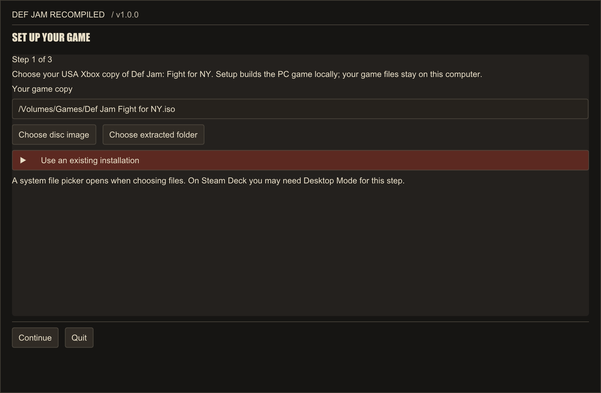
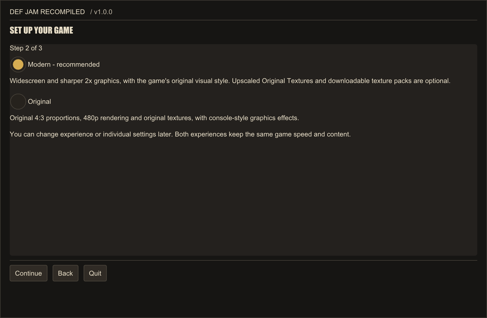
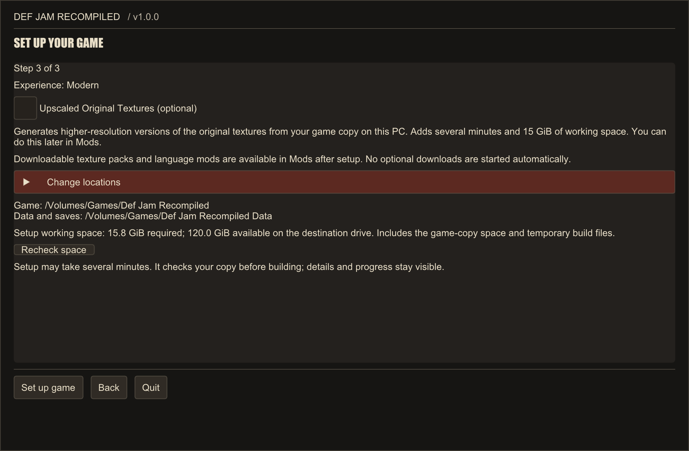
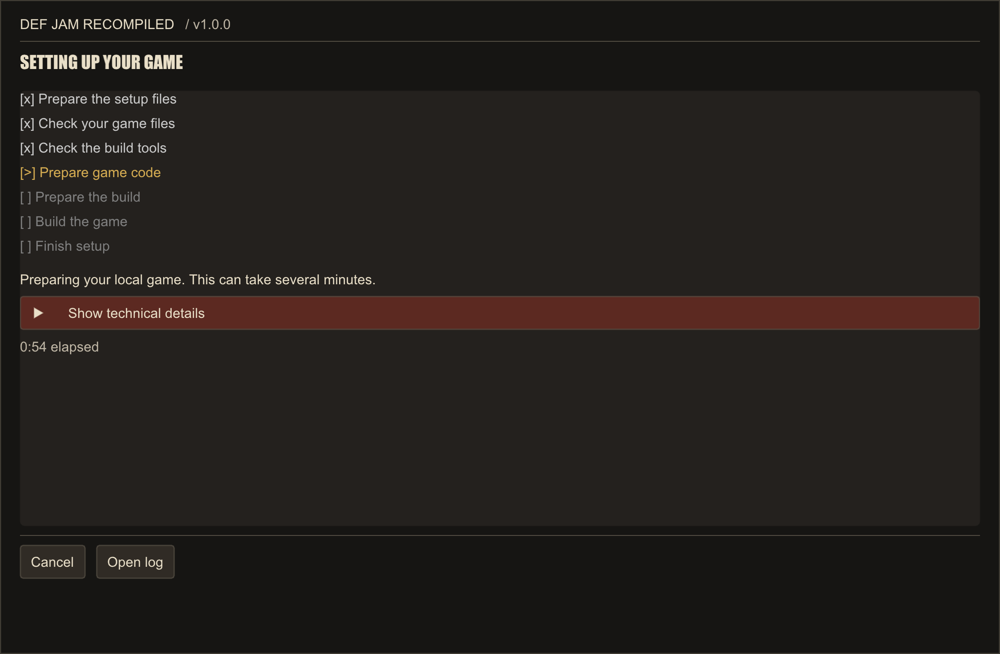
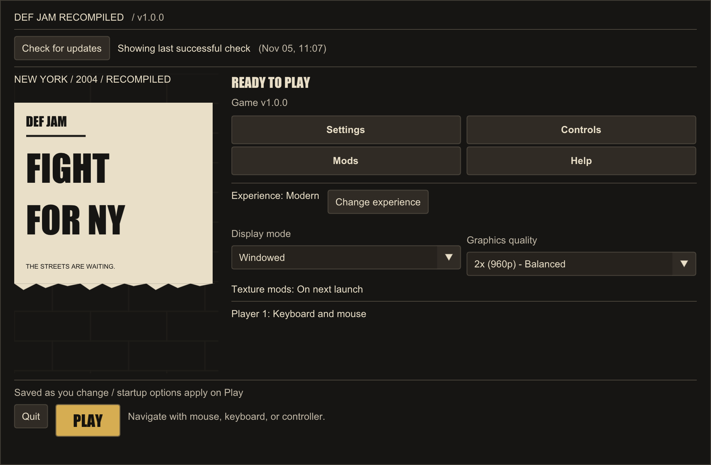

# Install Def Jam Recompiled

**Def Jam Recompiled** is one app that sets up, plays, updates and repairs the game. It holds no game
files: it checks your own copy and builds the game on your computer.

- [What you need](#what-you-need)
- [1. Download the app](#1-download-the-app)
- [2. Open it for the first time](#2-open-it-for-the-first-time)
- [3. Set up your game](#3-set-up-your-game)
- [4. Play](#4-play)
- [Add to Steam](#add-to-steam)
- [Updates](#updates)
- [Repair and uninstall](#repair-and-uninstall)
- [If something goes wrong](#if-something-goes-wrong)

## What you need

- **Your own USA Xbox copy** of Def Jam: Fight for NY, as a disc image (ISO/XISO) or an extracted folder,
  matching the [supported dump manifest](../config/dump-manifest.json). PS2 and GameCube copies can't be used.
- **A supported computer:** Windows x64, a Mac with Apple Silicon, or x86-64 Linux, including the Steam Deck.
- **Free space:** about 12 GiB of working space, plus the size of your copy and 1 GiB. Upscaled Original
  Textures need up to 15 GiB more. The app shows the exact figure before it starts.
- **Build tools:**

| Platform | What the game is built with |
|---|---|
| Windows | Microsoft's C++ Build Tools. If they're missing, the app offers to install them (a few GB from Microsoft, and Windows asks for your permission). |
| macOS | Apple's Command Line Tools. If they're missing, the app tells you how to install them. You can also run `xcode-select --install` in Terminal. |
| Linux and Steam Deck | Nothing to install. The app carries its own toolchain. |

## 1. Download the app

Get the file for your platform from the
[latest release](https://github.com/vyanhursky/DefJamFFNY-recomp/releases/latest):

| Platform | File |
|---|---|
| Windows x64 | `DefJamRecompiled-<version>-windows-x64.exe` |
| macOS, Apple Silicon | `DefJamRecompiled-<version>-macos-arm64.zip` |
| Linux x86-64 and Steam Deck | `DefJamRecompiled-<version>-linux-x86_64.AppImage` |

Each file has a `.sha256` checksum and a `.provenance.json` record beside it, so you can check the download.

## 2. Open it for the first time

The app isn't code-signed yet, so your system may ask you to confirm the first time.

### Windows

1. Open the `.exe`. If SmartScreen appears, choose **More info**, then **Run anyway**.
2. Choose where to keep the app. The default is `%LOCALAPPDATA%\Programs\DefJamRecompiled`.

Nothing is added to the Start menu or the desktop. To open the app again, open that file, or use
[Add to Steam](#add-to-steam).

### macOS

1. Unzip the download and open **Def Jam Recompiled**. You can keep the app wherever you like.
2. macOS blocks it the first time. Choose **Done**, not Move to Trash.
3. Open **System Settings → Privacy & Security**, choose **Open Anyway** beside the message, and confirm.

You only need to do this once.

### Linux and Steam Deck

1. Mark the AppImage as executable. On the Steam Deck, in Desktop Mode, right-click the file in Dolphin and choose
   **Properties → Permissions → Allow executing file as program**. In a terminal, run `chmod +x` on the file.
2. Open it, and choose where to keep the app. The default is `~/Applications`. It copies itself there as
   `DefJamRecompiled.AppImage`.

No menu entry or desktop shortcut is made. To open the app again, open that file, or use
[Add to Steam](#add-to-steam).

## 3. Set up your game

With nothing installed, the app opens on three short steps.

### Step 1: Choose your game copy

Choose **Choose disc image** or **Choose extracted folder**. Your game files stay on your computer, and your
original copy isn't changed.

On the Steam Deck, do this step in Desktop Mode, since it opens a system file picker.

**Already installed with the older setup?** Open **Use an existing installation** and choose its folder. Your
saves, settings and mods are kept.

### Step 2: Choose your experience

| | Modern (recommended) | Original |
|---|---|---|
| Picture shape | Widescreen, matching your screen | 4:3 |
| Render resolution | 2× (960p) | 1× (480p) |
| Anti-aliasing | MSAA 2× | MSAA 2× |
| Anisotropic filtering | 16× | Off |

Both keep the same game speed and content, and you can change your choice or any single setting later.

### Step 3: Review and start

- **Upscaled Original Textures** are optional. They're higher-resolution versions of the original textures,
  generated on your computer from your copy. They add several minutes, and you can generate them later in **Mods**.
- **Change locations** shows where the game and your data go. The defaults are:

| Platform | Game | Data and saves |
|---|---|---|
| Windows | `%LOCALAPPDATA%\DefJamRecompiled\app` | `%LOCALAPPDATA%\DefJamRecompiled\data` |
| macOS | `~/Library/Application Support/DefJamRecompiled/app` | `~/Library/Application Support/DefJamRecompiled/data` |
| Linux and Steam Deck | `~/Games/DefJamRecompiled/App` | `~/Games/DefJamRecompiled/Data` |

- **Free space** is checked here. If there isn't enough, free some up or change locations, then choose
  **Recheck space**.
- **On Windows**, if the Build Tools are missing, a checkbox offers to install them first.

Choose **Set up game** when you're ready.

### While it builds

The app works through its stages and shows how far it has got. This takes several minutes. On a Steam Deck
with Upscaled Original Textures, expect about 15 minutes, and keep it plugged in and awake.

If you choose **Cancel**, you can run setup again later and it picks up the work it already finished.

When it finishes, the app tells you the version it installed and offers **Play**.

## 4. Play

Home is where the app opens from now on. From here you can open **Settings**, **Controls**, **Mods** and **Help**,
and press **Play**. See [the app and overlay guide](launcher-and-overlay.md) and
[controls](10-input.md) for more.

Downloadable texture packs and language mods are in **Mods**. Nothing downloads by itself.

## Add to Steam

On Windows, Linux and the Steam Deck, **Add to Steam** sits beside **Play**. It adds the game to your library as a
non-Steam game, with its artwork. Steam has to close for this, so the app asks first. On the Steam Deck, do it in
Desktop Mode. After that, you can start the game from Gaming Mode.

Steam integration isn't available on macOS.

## Updates

When it starts, the app checks GitHub for a newer stable release, at most every twelve hours. **Check for updates**
on Home checks right away, and you can turn the automatic check off in Settings. Beta releases are never offered.

When your game is older than the app, choose **Update game**. The game is built again from your copy, in about three
to ten minutes. Your saves, settings and mods are kept, and the previous version stays playable until the new build
is ready.

## Repair and uninstall

Open **Help** on Home.

- **Repair or rebuild...** Repair checks this version's files and rebuilds what's missing. Rebuild builds the game
  again from nothing. Your saves and settings are kept.
- **Uninstall...** removes the game build, and its Steam shortcut if the app added one. Your data folder stays
  unless you tick **Also delete the data folder**. If you do, your saves and settings are first copied to a
  `Def Jam Recompiled saves <date>` folder in Documents. On macOS and Linux, you then delete the app file yourself.

## If something goes wrong

If setup stops, it tells you why and offers **Try again**, **Change setup options** and **Open log**. Your installed
game, if you have one, stays unchanged and playable.

See [troubleshooting](troubleshooting.md), then
[report the problem](https://github.com/vyanhursky/DefJamFFNY-recomp/issues/new/choose) and include the setup log.
Please don't attach F9 bug bundles, game files or dumps.

## Other ways to install

- Also available on [RecompLauncher](https://recomplauncher.com/game/defjamffny-recomp) and
  [Quiver](https://quiverlauncher.com/apps/def-jam-fight-for-ny-def-jam-fight-for-ny-fan-recomp).
- [Setup installers](setup-installer.md): the older `DefJamSetup` tools, including silent installs,
  available on releases before v1.1.0. Current releases publish only the app packages above.
- Build by hand: [Windows](build-and-play.md) or [macOS and Linux](build-macos-linux.md).
