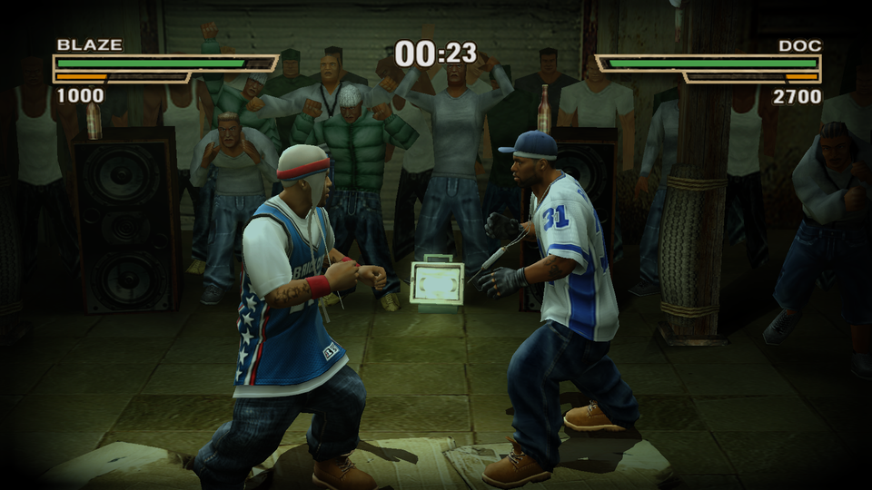
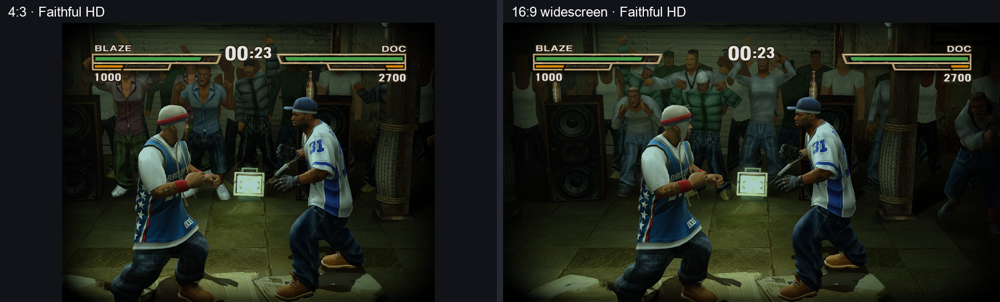
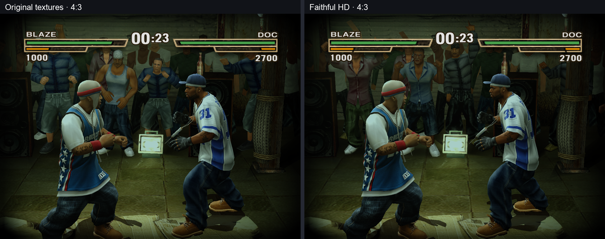
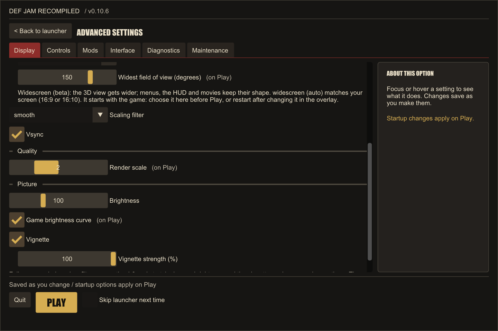
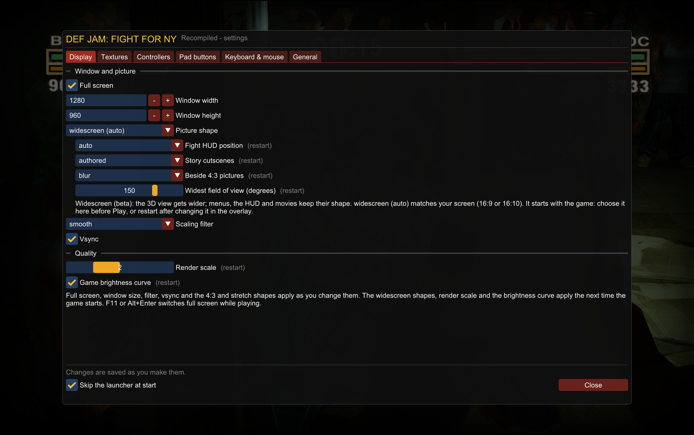

# Gameplay and interface gallery

[Back to the project](../../README.md) · [Capture guide and remaining shots](capture-plan.md)

These are real captures of the native Mac port. The launcher Home and Advanced
screens were captured on October 20, 2026; gameplay and the historical overlay were recorded on October 13, 2026
on an Apple M1 Pro running macOS 26.5.2, using Vulkan/MoltenVK. Gameplay uses
render scale 2, the game brightness curve and locally generated faithful HD
packs where labelled. Widescreen beta shipped in
[v0.9.0](https://github.com/vyanhursky/DefJamFFNY-recomp/releases/tag/v0.9.0)
on Windows, macOS and Linux/Steam Deck. These images do not demonstrate Deck
Gaming Mode or Windows-specific rendering.

## Fight preview

The owner-selected face-off at simulation step 1200 shows both fighters,
a readable HUD and clothing detail. The README uses a compact three-second, 480×270 GIF.
[Download the longer fight clip](hd-16x9-gameplay.mp4) (silent MP4, 60-fps export).
MP4 links open GitHub's file page for download; they are not inline video players.

## Widescreen beta

Owner-selected face-off: same seeded fight, simulation step 1200, scale and
HD packs on both sides.
The 16:9 view reveals more of the arena horizontally while preserving vertical
framing and moving the health bars toward the edges. The 4:3 image is fitted
inside the left panel without stretching.

[Download the widescreen comparison clip](widescreen-comparison.mp4) (silent MP4).
The recordings start at different moments; use the still for the matched pose.

## Original and faithful HD textures

Same seeded fight at simulation step 1200, 4:3 framing and render scale 2.
Only the texture packs change. Clothing, floor and crowd detail are easier to
compare at full image size; HD is a faithful upscale, not replacement artwork.
Background crowd animation can differ between captures.

[Download the texture comparison clip](textures-comparison.mp4) (silent MP4).
Both recordings follow the same seeded inputs but are not frame synchronized.

## Launcher and F1 overlay

FFNY Online's launcher (build 26, signed out): the logo and PLAY on the left, glass cards for the
account, the game's build and the news on the right. It replaces upstream's v0.10.6 Home screen in
this fork, so `launcher.png` here is FFNY Online's own capture (fingerprint in
`scripts/check-source-tree.py`), not the one in the table below.

Advanced groups the shared settings into Display, Controls, Mods, Interface,
Diagnostics and Maintenance. Focus or hover an option for its explanation.
These are real native macOS UI captures, not Steam Deck or Windows captures.

Historical v0.9.0 F1 overlay capture, retained as a gameplay-overlay example. The
current overlay shares the new Advanced categories and theme shown above. It
does not pause gameplay; options marked **on Play** apply on the next launch.

## Setup example

FFNY Online's build 26 Windows setup wizard, with example folders typed in.
See the [setup guide](../setup-installer.md) for current behavior.

## Capture provenance

The owner requested review, selection and inclusion of this supplied capture
set in PR #22 on October 13, 2026. Only the selected exports below are published,
with exact fingerprints in `scripts/check-source-tree.py`. On October 14 the
owner selected option B, the step-1200 face-off, for the hero and widescreen
comparison; these replace the earlier step-1500 exports. Raw recordings,
simulation streams, native masters and diagnostic contact sheets stay local.

Gameplay stills, GIF and videos: PR #12 source `a7dc1b7`, CI merge `d319a802`,
toolkit `872fbc3`. These precede the final Mac correction and are candidate
captures, not recordings of the tagged installer. Historical overlay:
corrected source runtime inputs certified to match v0.9.0 commit
`c4bcda69b3dc839a3705bfb443fc774d7828f33a` (compiled before the commit).
The historical overlay executable SHA-256 is
`f4aaee1f7cd07ae411c07e67d121a03bb87b73cc615950d2319ba1f514570adf`;
Mac helper SHA-256 is
`2a44eced81b0f8d933969082dc42aaea245ca3777835af981755978a445ba22c`.

Current Home/Advanced exports: source `ffb428b` with only the CMake version changed
to 0.10.6 before capture; toolkit `32aab4d`. Executable SHA-256:
`ef478860ad10ddacb3586fab744e6471b688c56b3a1afdf4c33a7541645a0f75`.
Captured through SDL/Metal at 2400×1600 pixels and downsampled to 1440×960;
no visual mockup or game artwork was added. The owner requested this replacement
on October 20 (D144). Disposable data and the complete-save-root guard were used;
restoration passed. Local receipt: `logs/launcher-review/beta-20261020/receipt.json`.

The local master set is `logs/widescreen-macos/media/` in the capture checkout,
with identities in `exports.json`. Seed `20261006`; the five texture/aspect
variants each match the same 80-record simulation stream. Stills are the first
presented frame at or after the named step, so background animation may vary.
Videos are silent 60-fps CFR exports resampled from window-recording timestamps;
encoded cadence does not establish measured game performance. The GIF is 20 fps.

HD recipe: `a512d2429f11f9ab03d2eaef65df53afd0a2a2536cfe67af638156ba69bb00ec`,
channels and opacity packs. Pack manifest SHA-256 values:
`7b6b24a686e171a2aeab67478224d2749f452aa4d4e92402c109968cbdfa2920`
and `ac3583188a87e46dc7f183969f2b51dd0300cf3d6bd05ca3ecf40513c61f4d2f`.

| Export | Dimensions / cadence | Size | SHA-256 |
|---|---|---|---|
| `gameplay-hero.png` | 960×540 | 0.60 MB | `f0f9f8524913594e7b0d676bbe241c5733f6f4fd4eba2206c4f593638e0814e4` |
| `gameplay-preview-compact.gif` | 480×270, 3 s / 20 fps | 3.45 MB | `88b8c8747d6b3936203191aca261ed0ca85108e2ae4bb914f0b0773495f641ec` |
| `textures-comparison.png` | 1932×764 | 1.59 MB | `bfb4bfdd75b28268cf2cea5638f1fe6962e9ac2e30f2b275dc800c13a8fd9e8a` |
| `widescreen-comparison.png` | 1932×584 | 1.08 MB | `dd8b23a051e8ef98516ea6aa349ef450f441e58669efc67a56fb2273dfbeaf67` |
| `launcher.png` | 1440×960 | 0.18 MB | `61be58a7a76224e0ac5f8d42689c715294d323b2f1ed559491f019a93a2ef693` |
| `launcher-advanced.png` | 1440×960 | 0.24 MB | `2b314e1d96c797a56e475b2d18cae0d502e5a6c944b07af2c8307bbd0dc3060a` |
| `overlay.png` | 1800×1130 | 0.59 MB | `a137a13fa65cbbfc765897aa9d51d3ef84523e5cabd0fe934f6e477f446ca09b` |
| `hd-16x9-gameplay.mp4` | 1280×720, silent 60-fps CFR | 5.57 MB | `385b041f57b7ddd61feb99e0ce726f6e4a5856f1e9936c416aca81949ee428f0` |
| `textures-comparison.mp4` | 1280×520, silent 60-fps CFR | 3.88 MB | `0659c294460c00fafd69552a2f4fb0c70d161b5d6206e78c902cdd4ca3a03383` |
| `widescreen-comparison.mp4` | 1280×400, silent 60-fps CFR | 2.65 MB | `2916fc4efd72b6d109d829157c01479c9ef50d84c5bbb94437d3fd87060f7d2c` |
| `developer-menu.png` | 1830×1336 | 0.24 MB | `86a3a91ae252ff9692003e3b88ee8bbc68af176ab74bb7fa0db4e4fd5add9077` |

## Earlier captures

The [early Windows still](fight-screenshot.png) and
[six-second 12-fps GIF](fight-gameplay.gif) remain as historical examples,
approved October 4, 2026 (D58). They are no longer the README hero/preview.
The historical setup image retains its existing fingerprint.

Game artwork belongs to its respective rights holders. The project's MIT
license does not cover it. Approval applies only to these exact exports and
does not permit publishing raw game assets, saves or other recordings.
