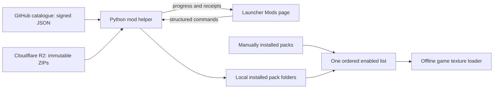

# Launcher mod manager: agreed direction and implementation plan

For current combined RC status, see the [integrated launcher/menu acceptance
record](integrated-menu-launcher-rc-2026-10-23.md). This dated design and implementation
snapshot preserves the earlier decisions and validation context.

2026-10-21. Design follow-up to [PR17](https://github.com/vyanhursky/DefJamFFNY-recomp/pull/17),
head `8e3d2dbe8f8debbc76d1e317307e3c23f77ba2e3`. This is an implementation plan;
the download manager and catalogue are not yet shipped features.

## Owner decisions

Vlad requests three connected launcher surfaces: local filesystem mods, approved project downloads,
and a load-order sub-window covering both. The HD/Widescreen Menus pack is a separate product;
it must override conflicting Faithful HD textures when placed later. Faithful remains independently
generated from the player's dump. Catalogue updates and mod updates are user-controlled.

Vlad confirmed one new public `vyanhursky/DefJamFFNY-mods` repository, signed **JSON** as in PR17,
and keeping the helper in the game repository initially. Catalogue publishing uses GitHub Actions
with a protected environment requiring his approval. He accepts Cloudflare R2 and modest costs,
but has no account/domain yet and requests recommendations. No domain purchase is needed to begin.

## Verified starting point

Current main inspected at `a0c9109f01dcf77f4123e12d005b76dc5b6f15ed`, not just this older menu branch:

- `src/hooks/pc_ui.cpp` already has a Mods page, local discovery, enable/disable, refresh, open-folder,
  Earlier/Later ordering, environment locks and restart notices.
- `src/hooks/pc_ui_model.h` inventories schema-1 `manifest.ini` folders, preserves missing selected
  names, and serializes one semicolon-separated order. Its current rows carry folder names, not
  catalogue identity/version/provenance.
- The runtime loads unpacked texture folders; later enabled packs win. It does not load ZIPs directly.
  PR73's longer pack-list support must be present in the integration base; do not restore the old limit.
- Setup retains `source/` and `python/` under each installed version on all three platforms
  (`setup/engine.py`: `RUNTIME_FOLDERS`, `Engine.__init__`, payload staging). A Python helper can use
  the existing runtime without asking the player to install Python.
- General guest-file/archive-entry schema-2 overrides remain future work. They are not required to
  deliver catalogue texture downloads and the requested shared load order.

Implement on a new topic branch based on current main, preserving PR62's independent artwork/export
work and the current review server. Recheck other agents' active work before integration.

## Launcher behavior

| Surface | Behavior |
|---|---|
| Local mods | All discovered pack folders, including catalogue installations; origin badge, enable checkbox, metadata when known, invalid/missing state, Refresh and Open Mods Folder. Never infer catalogue ownership from a matching folder name. |
| Project catalogue | Curated available mods with description, installed/latest version, compatibility, download size, Install/Update/Cancel and progress. Installation does not silently enable a mod. Cached results remain visible offline with their age. |
| Load Order | A separate modal/sub-window containing all enabled local and managed mods in one order. Label top as lower priority and bottom as higher priority. Mouse/gamepad/keyboard Earlier/Later controls; drag ordering can follow. Show restart requirement. |

Use a single ordered list internally, not separate local and official precedence lists. One row per
installed pack; catalogue discovery joins managed receipts to those rows rather than duplicating them.
Faithful may consist of several component folders: retain their internal order and expose their actual
folders in the first implementation. Grouping must not silently reorder components.

For the menu pack, recommend placing it after enabled Faithful components; show conflicts and which
pack wins. The player retains control of order. Disabling or moving a mod keeps its files. Updates
preserve enablement and relative order. Missing entries remain visible, so a disconnected folder does
not silently lose its position. Respect `RECOMP_TEXTURE_PACKS` locks and keep the advanced text field.

The in-game overlay can show current state and next-launch ordering changes, but package mutation
belongs in the launcher with the game stopped. A download/check must not freeze the UI or block offline
Play. During the brief install commit, synchronize Play with the mod transaction lock. Never start a
game against partially switched pack files.

## Repository and process boundaries

`DefJamFFNY-mods` contains source metadata, schema, validation/index generation, contribution rules and
review/sign/publish workflows. It contains no derived artwork ZIPs. GitHub Pages serves the signed
catalogue; R2 serves artwork downloads. One additional repository suffices for v1. Extract a reusable
helper repository only when another project needs it.

In the game repository, keep helper modules beside the existing Setup Python tooling, with a stable
headless CLI and JSON-lines progress. Resolve its script/interpreter through the installed version's
trusted paths, not user-controlled catalogue commands or a shell command string. Reuse existing
transaction/download patterns where they fit, but do not weaken Setup's existing asset verification.
Account for developer checkouts and old installations without a helper: local discovery/Play still work.

## Catalogue and install contract

Use a stable identity such as `menu-ui-hd-wide` and an independent version such as `1.0.0-rc2`;
today's `menu-ui-hd-wide-v1-rc2` is an export folder name, not the future update identity. Record
the archive root explicitly so the current one-folder ZIP can be imported without renaming art files.
Use prerelease/stable channels, explicit runtime capabilities (including wide-layer support), platform
constraints where needed, exact compressed/unpacked sizes and SHA-256, HTTPS mirror URLs, credits,
content licence/permissions, reviewed status, dependencies, conflicts and suggested ordering.
Do not label derived art as MIT just because the installer source is MIT.

Maintain one source metadata file per mod and append-only released version records. A catalogue
revision and expiry belong inside the signed payload. Verify the signature over exact downloaded
bytes before parsing/trusting the index; pin public keys in the shipped helper, reject rollback below
the last accepted revision, and document key rotation/recovery. Expired cached metadata may describe
already installed mods, but must not authorize fresh installs. Offline play stays available.

Publishing jobs must not expose signing/upload credentials to untrusted PR code. Validate PRs with
synthetic fixtures and read-only permissions. After review, rebuild the exact approved main commit in
a protected environment requiring Vlad; sign and deploy the verified output. Keep key material out of
source, artifacts and logs. A repository-controlled signing workflow still needs protection: signed
metadata is not a substitute for reviewing workflow changes and protecting release credentials.

Downloads are resumable to private staging, pinned by size/hash, and extracted with strict limits.
Reject traversal, absolute/drive/UNC paths, links, duplicates/case collisions, encrypted archives,
unsupported file types and expansion beyond signed bounds. Validate every manifest-referenced image
and wide slab, not just the manifest header. Preview/layout resources never become executable hooks.
Cancellation or failure keeps the previous installation usable.

Use private manager state outside the runtime-scanned `mods/` folder for cache, staging, receipts,
rollback and locks. Managed ownership is an explicit receipt with identity, version, original archive
hash and installed-file hashes. Local folders, including symlinked developer packs, remain discoverable;
the installer must never traverse/overwrite a local symlink or take over an unrelated folder.

Stage on the same filesystem as the installed pack, verify first, then use a recoverable rename journal
to switch the complete folder. Windows cannot atomically replace a nonempty directory: do not call a
two-rename update atomic without recovery. Recover interrupted commits before Play. Keep one prior
managed version for explicit rollback; never delete arbitrary local folders. Detect local edits to a
managed pack and require an explicit preserve/reset decision before replacing them. Serialize helper
writers and launch commits. Track download/verification/commit phases separately in the UI.

Keep `[textures] packs` as the runtime source of precedence for this texture-only increment. Add no
competing `[mods] enabled` authority yet. The generalized schema-2/file/archive work in PR17 can later
migrate this list deliberately. State/receipts describe installation; they must not silently override
the settings order.

## Hosting recommendation

Create a Cloudflare account owned by Vlad with MFA. Use R2 **Standard** storage and a dedicated bucket.
Initially use its development URL for integration tests. Before public release use a custom subdomain,
for example `downloads.<chosen-project-domain>`; catalogue stays on GitHub Pages. If there is no existing
project domain, choose a durable project-wide name and use subdomains rather than buying one per mod.
Domain availability/pricing has not been checked; no purchase or account creation is authorized by a
particular suggested name here.

Cloudflare documents `r2.dev` as rate-limited and for development, and custom-domain access as the
production route ([public buckets](https://developers.cloudflare.com/r2/buckets/public-buckets/)).
Standard includes 10 GB-month storage, 1M Class A and 10M Class B operations monthly; extra storage
is $0.015/GB-month and direct R2 egress is free. Other connected services can add charges
([pricing](https://developers.cloudflare.com/r2/pricing/), checked 2026-10-21).

RC2 is **421,563,157 bytes download / 423,392,524 bytes installed**. Ten same-sized ZIP versions are
about 4.22 GB of storage. Prefer immutable object keys containing mod ID/version/archive hash; never
replace the bytes behind a published version. Keep old versions for rollback. Serve ZIPs with byte
range support and exact Content-Length; the client verifies full content regardless of cache/mirror.
An R2 download needs no Cloudflare credentials on the player's computer. Restrict upload credentials
to the dedicated bucket and publishing workflow; choose cache headers intentionally for immutable
ZIPs versus revocable metadata. Confirm budget notifications before publishing.

## Implementation slices and acceptance

1. **Catalogue foundation:** source-only repository, schema/spec, deterministic index builder, synthetic
   fixtures, contribution/append-only rules, PR validation and protected sign/publish workflow. Begin
   with an empty/test catalogue; do not advertise the menu RC as a stable release.
2. **Local helper core:** discover/merge identity, cache and verify catalogue, validated archive import,
   transaction/rollback/ownership journal, cancellation and recovery; CLI JSON progress. Test with
   synthetic packs and a loopback HTTP fixture before hosting any artwork.
3. **Launcher integration:** retain the latest launcher design; split local/catalogue surfaces and add
   shared Load Order window, helper lifecycle/progress, update badges and offline behavior. Bundle
   pinned verification dependencies in all Setup platforms; explicitly test old-install fallback.
4. **Hosted end-to-end:** create R2 when Vlad's account/domain is ready, upload a synthetic package,
   prove range resume/hash failure/rollback and review-approved catalogue publication. Then exercise
   the actual separate menu ZIP in an isolated data/save root with Faithful on and off.
5. **Release acceptance:** native mouse/keyboard/gamepad checks, narrow-window/large-text layout,
   Windows/macOS/Deck install/update/uninstall/cancel/interruption, dependency/conflict and shared
   precedence cases. Runtime/lifter/renderer changes retain the repository's full regression gates.

Specific failure tests: corrupt/truncated download, ignored/invalid range response, wrong size/hash,
bad/expired/rolled-back signature, revoked or incompatible version, malicious archive, insufficient
disk, locked files, app exit during switch, concurrent helper/Play, local-name collision and edits,
offline first launch and offline cached launch. Disabling/removing a managed pack must reveal the
underlying Faithful/original texture. Failed updates must retain old version, enablement and order.

The menu RC has separate native acceptance gates in
[the RC report](menu-ui-separate-release-candidate-2026-10-20.md), including the inherited transition
black rectangle. Completing the manager does not resolve those renderer/playtest issues or silently
approve pending artwork derivatives.

## Remaining owner setup

- Cloudflare account and eventual domain choice. Development and local integration can proceed now.
- Provision the catalogue signing key and owner-review environment without exposing credentials in
  chat; confirm recovery/key custody before the first trusted publication.
- Public menu release remains gated on its existing native review. No additional art generation is
  requested by this mod-manager implementation.

## Foundation delivered in this session

Created [vyanhursky/DefJamFFNY-mods](https://github.com/vyanhursky/DefJamFFNY-mods), initial source
commit `adf8099`. The repository contains the draft texture metadata contract, strict standard-library
validator, deterministic unsigned preview builder, contribution rules, MIT source licence, and
read-only PR/push validation. Seven tests (including eighteen invalid-metadata cases) and Actions run
`39612826714` pass. The real catalogue is empty; synthetic URLs/hashes appear only in tests.

Created GitHub environment `catalogue-release` with required reviewer `vyanhursky` and a deployment
branch policy allowing `main` only. Owner-triggered deployments can be approved by that owner; there
is currently no publishing workflow to consume the environment. No signing key, Pages deployment,
Cloudflare resource, downloaded artwork or launcher/helper implementation was created. This foundation
does not yet enforce published-version immutability, archive verification, trust or installation.

Local catalogue checkout: `logs/mod-catalogue-foundation/` (its own Git repository, ignored by the
parent). Future changes should use a `codex/` topic branch and PR. Its public source is recoverable
independently of the private menu artifacts. Start helper/UI work from current main in a separate
worktree; do not replace the redesigned launcher with this art branch's older UI.

## Implementation delivered — 2026-10-21

The current-main implementation is in [draft game PR82](https://github.com/vyanhursky/DefJamFFNY-recomp/pull/82)
(source eb6c65e), preserving this older menu branch's artwork and review work.
Read the PR's validation report for569passing units, three native synthetic tours
repeated twice, full15/18 and fresh launcher/intro2/2. Catalogue protected signing
is [PR1](https://github.com/vyanhursky/DefJamFFNY-mods/pull/1),3597c0e. Owner explicitly
approved key generation/private backup/protected-secret provisioning; complete.
No live Pages catalogue or public art hosting has been published.

[Storefront assessment](mod-storefront-integration-2026-10-21.md): keep R2 primary
for the imggen menu pack. GameBanana's AI-art policy requires training-data
knowledge we cannot document; seek clarification before listing. Thunderstore
needs community/content acceptance and a validated wrapper adapter; Quiver needs
the external-data path/enable-order bridge. Host-independent URLs preserve the
signed catalogue and shared order regardless of the future host.
